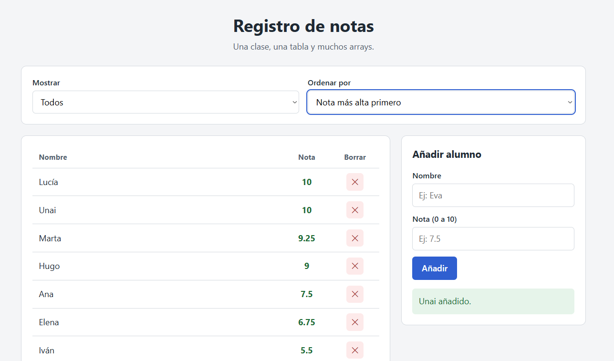

# Registro de notas

Página web para ver, filtrar, ordenar, añadir y borrar alumnos de una clase, hecha con JavaScript y arrays.
Práctica de Desarrollo Web en Entorno Cliente · 2º DAW · IES Juan García Valdemora.

**Página publicada:** (https://unaipescador2-cmd.github.io/Registro-notas/)

## Vista de la página

## Qué hace

- Muestra una tabla con el nombre y la nota de cada alumno. Las notas aprobadas se ven en verde y las suspensas en rojo.
- Permite mostrar todos los alumnos, solo los aprobados o solo los suspensos.
- Permite ordenar por nombre, por nota de mayor a menor o por nota de menor a mayor.
- Permite añadir alumnos (con comprobación del nombre y de la nota) y borrarlos con el botón ✕.
- Muestra un resumen con el número de alumnos, la nota media, la nota máxima y los aprobados.

## Archivos del proyecto

| Archivo | Para qué sirve |
|---------|----------------|
| `index.html` | La página. |
| `estilos.css` | El diseño. |
| `notas.js` | Las funciones que trabajan con la lista de alumnos. No toca la página. |
| `app.js` | Conecta la página con las funciones y dibuja la tabla. |
| `notas.md` | Mis apuntes de cada fase. |

## Cómo usarlo

1. Descarga o clona el repositorio.
2. Abre `index.html` en el navegador.

## Funciones de `notas.js`

### Funciones que cambian la lista

Modifican el array que reciben, porque usan `push`, `pop` o `splice`.

- `anadirAlumno`: añade un alumno al final.
- `quitarUltimo`: quita el último alumno.
- `insertarEn`: mete un alumno en una posición.
- `borrarPorNombre`: borra al alumno con ese nombre.

### Funciones que no cambian la lista

Devuelven una copia o un dato, y dejan la lista como estaba.

**Devuelven una copia o un array nuevo:**

- `ordenarPorNota` y `ordenarPorNombre`: copia ordenada.
- `aprobados`: array nuevo con los aprobados.
- `ranking`: los n mejores alumnos.
- `filtrarAlumnos`: copia con los alumnos que cumplen el filtro.
- `ordenarAlumnos`: copia ordenada según el criterio.
- `nombresAprobados`: array nuevo con los nombres de los aprobados.

**Devuelven un dato:**

- `buscarPorNombre`: un alumno, o `undefined`.
- `notaMedia`: un número.
- `notaMaxima`: un número, o `null`.
- `hayAlgunDiez` y `todosAprobados`: `true` o `false`.
- `esNotaValida`: `true` o `false`.

En `app.js`, solo `manejarAnadir` y `manejarBorrar` cambian la lista `alumnos`, y lo hacen a través de `anadirAlumno` y `borrarPorNombre`. `pintarTabla` solo lee la lista.

## Decisiones

- La lista verdadera es el array `alumnos`. Filtrar y ordenar trabajan con copias y no la modifican.
- La nota se puede escribir con punto o con coma (`7.5` o `7,5`).
- No se pueden repetir nombres. La comparación distingue mayúsculas, así que `Ana` y `ana` cuentan como nombres distintos.

## Autor

NOMBRE Y APELLIDOS